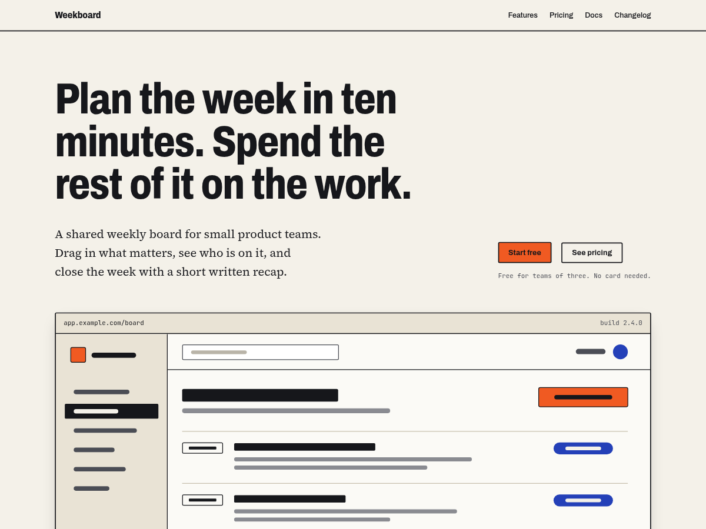

# Shipnote

A free WordPress block theme for the website of a small software product: a landing page, pricing, docs pages and a changelog page that lists release notes by date.

The visual idea comes from paper dispatch notes: warm off-white paper, black ink rules, a signal-orange accent, dashed tear-off lines and monospaced dates. Headings use Archivo (semi-condensed), body text uses Source Serif 4, and dates and version numbers use JetBrains Mono. All three fonts are bundled under the SIL Open Font License, so the theme loads nothing from other servers.



Status: 1.0.0, not yet submitted to WordPress.org. It passes the Theme Check plugin with no required items, every bundled pattern validates in the block editor, and a Create Block Theme export reproduces the templates and patterns unchanged.

## Features

- Pure block theme, `theme.json` version 3, no plugin or JavaScript framework needed.
- Templates: front page, blog index, single post, page, page without title, wide page, docs page with a sidebar, changelog page, blank canvas, archive, search and 404.
- Changelog: the Changelog page template and the `changelog` category archive list posts from that category as dated release notes with their full text. `functions.php` adds the category to the query, because the Query Loop block stores categories by ID. Another slug can be set with the `shipnote_changelog_category` filter.
- Header, footer and docs sidebar template parts.
- Patterns: hero with a framed product screenshot, text-only logo strip, feature grid, three-plan pricing, FAQ (core Details block), testimonials (placeholders labelled "Sample quote"), call-to-action band, release notes entry (version tag, Added / Fixed / Changed), docs article with an "On this page" list, team, contact. Helper patterns cover the templates.
- Block styles: perforated separator, ticket group, tag paragraph, checklist list.
- Style variations: Night shift (dark) and High contrast (black on white, yellow signal, heavier rules).
- Fluid type scale and spacing presets.
- Accessibility: skip link from core, visible focus ring on every control, colour pairs checked against WCAG AA, reduced-motion support.
- RTL-safe CSS (logical properties) and translation-ready (`shipnote` text domain; every string in the patterns goes through gettext).

## Development

Requirements: Node.js 20 or later, and Google Chrome for the screenshot tools. No PHP or Docker install is needed because WordPress runs in [WordPress Playground](https://wordpress.github.io/wordpress-playground/).

```bash
npm install

npm test              # static checks: block markup, pattern headers, i18n, contrast, readme
npm run lint:php      # PHP syntax check under PHP 7.4 (the minimum the theme supports)
npm run playground    # WordPress with the theme unit test data at http://127.0.0.1:9400
npm run demo          # clean demo site at http://127.0.0.1:9401 (add ?shipnote_style=night to preview a variation)
npm run theme-check   # builds dist/ and runs the Theme Check plugin against it
npm run validate:blocks  # with the demo running: checks every pattern parses as valid blocks in the editor
npm run cbt           # built theme plus the Create Block Theme plugin at http://127.0.0.1:9402
npm run zip           # dist/shipnote-<version>.zip, theme files only
npm run pot           # regenerates languages/shipnote.pot with WP-CLI inside Playground
npm run shots -- http://127.0.0.1:9401 tmp/shots / /changelog/   # desktop and mobile screenshots
npm run screenshot    # regenerates screenshot.png (1200x900) from the demo site
```

The zip is built from an allowlist (`tools/build-zip.mjs`), so `node_modules`, tests, tools and git data never end up in it.

## Project layout

```
style.css, theme.json, functions.php, readme.txt   theme headers, global styles, setup
templates/   block templates
parts/       header, footer, docs sidebar
patterns/    block patterns (PHP, so strings are translatable)
assets/      fonts with their licences, theme.css, the sample screenshot image
tools/       Playground blueprints, build, Theme Check and screenshot scripts
tests/       Node test suite
```

## Credits and licence

Shipnote is a personal project by Sunnatulla E. ([atokim4](https://github.com/atokim4)), released under the GNU General Public License v2 or later, the licence WordPress.org requires for themes in its directory. See `LICENSE`.

Fonts: Archivo (Omnibus-Type), Source Serif 4 (Adobe) and JetBrains Mono (JetBrains), each under the SIL Open Font License 1.1; the licence text is next to each font in `assets/fonts/`. The sample product screen in `assets/images/` was drawn for this theme.

All texts in the patterns (product name, features, prices) are sample content to be replaced.
